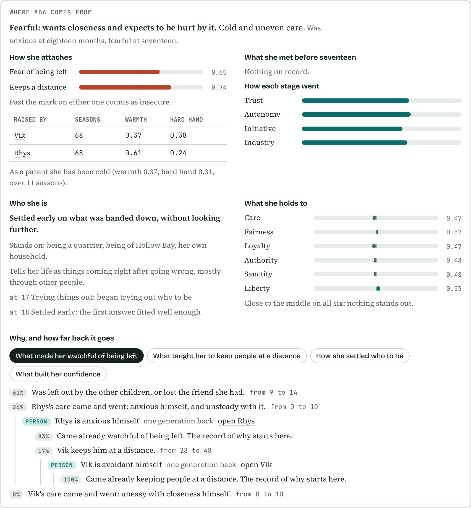
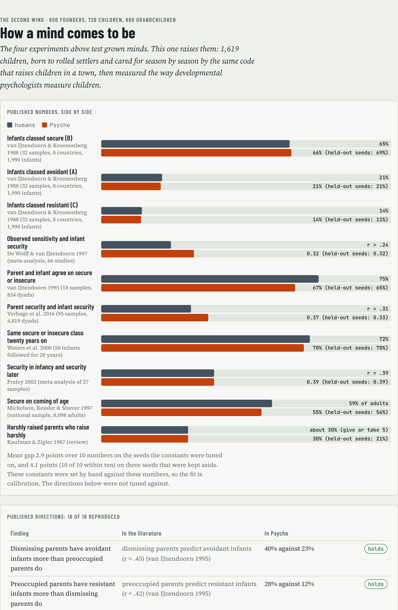
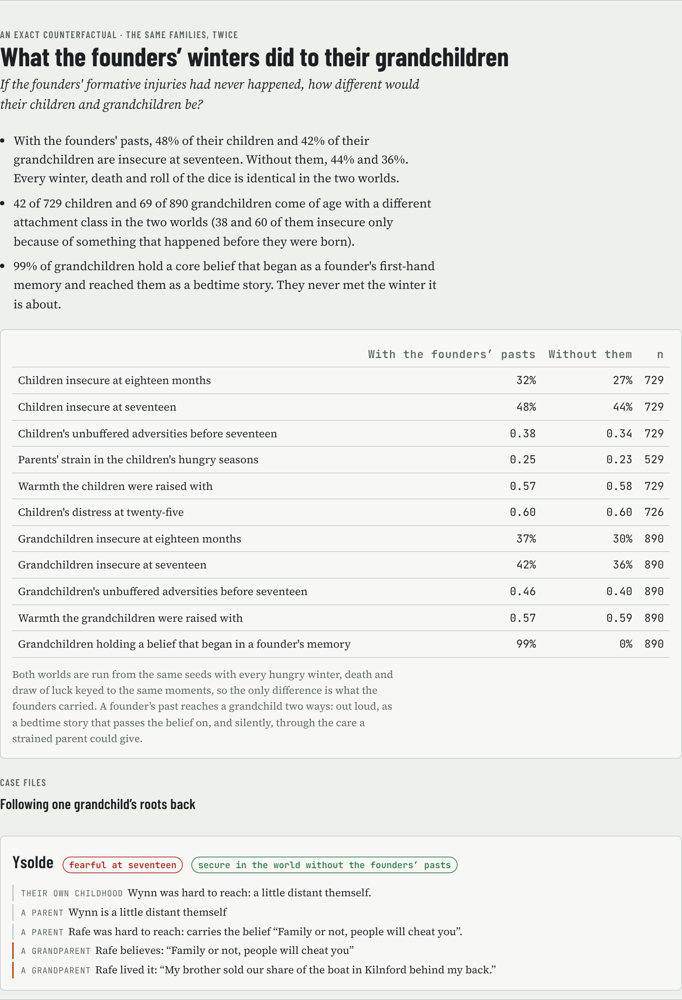

# Psyche

A world of artificial minds whose psychology is real machinery you can open up, not a personality written into a prompt.

**Kettle Island** is a live simulation of five people on a small fishing island. Each one runs on the mind engine: real memory that fades and gets rewritten, moods, trust, goals, sleep. Nobody is scripted. You watch them go about their days, bump into each other, gossip and hold grudges, and you can open any of their heads at any moment to see why they did what they did.

**Psyche Live** is the game built on top of it: a civilization of these minds that runs nonstop in 3D, which you watch, steer and (from G2) reach into. The plan for the game is at https://claude.ai/artifact/GiHxNDat1aGpxQC1UpqEek.

The design proposal behind the engine lives at https://claude.ai/artifact/7iL2xRmmVXMeDJYnBxDP7G.

## Run it

```bash
npm install
npm run dev        # server on :8787; the game on http://localhost:5173, the lab on http://localhost:5173/#/lab
npm run island -- 3 7 --storm   # three days of island life in the terminal (seed 7, with a storm)
npm run village -- 8 11         # eight days of Hollow Bay, the village, in the terminal
npm run generations -- 10       # ten years of Hollow Bay on the mock: lives, norms, inherited fears
npm run region -- 22            # a region of towns: splits, trade, laws, and the crossing told differently
npm run world                   # a realm of 50,000 minds on worker threads that runs for days (docs/world-server.md)
npm test           # engine and world tests
npm run demo       # the original single-mind demo (M0)
```

With no Anthropic credentials, speech runs on an offline mock so everything works out of the box. Set `ANTHROPIC_API_KEY` (or `PSYCHE_FACULTIES=claude`) to use Claude. The easiest place for the key is a `.env` file at the top of the repo, which git ignores and the server reads on start:

```
ANTHROPIC_API_KEY=sk-ant-...
PSYCHE_DAILY_CAP=5
```

Anything set in your shell wins over the file. Set `PSYCHE_AUTOPLAY=0` to start paused, and `PSYCHE_SCENARIO=village` to start in Hollow Bay (or switch worlds from the menu in the header).

### Cost

Every model call goes through a budget governor (`packages/faculties/src/governor.ts`):

- **Tiers.** Speech, perception, memory reconstruction and dreams run on `claude-haiku-5-5`; deliberation and the Architect on `claude-sonnet-5-5`. Override any faculty with `PSYCHE_MODEL_PERCEIVE`, `PSYCHE_MODEL_SPEAK`, `PSYCHE_MODEL_RECONSTRUCT`, `PSYCHE_MODEL_DELIBERATE`, `PSYCHE_MODEL_DREAM` or `PSYCHE_MODEL_ARCHITECT`.
- **Templates for small moments.** The engine scores how much each line matters. Greetings and small talk come from templates; replies that tell a memory, answer you, or follow deliberation go to the model. Whoever you are looking inside always speaks with the model.
- **A daily cap**, default $10 (`PSYCHE_DAILY_CAP`), shared by every run on the machine and kept in `~/.psyche/usage.json` (every call is logged beside it in `usage.log`). At 80% of the cap Sonnet calls drop to Haiku, at 90% only the most salient lines use the model, and at 100% everything falls back to the mock until the next UTC day. The world keeps running throughout.
- **One Opus call per question to the Historian** (`claude-opus-5-5`, `PSYCHE_MODEL_HISTORIAN`), only when you ask one. Nothing else uses Opus.
- **A live meter.** The `$` chip in the island header opens a breakdown by faculty and model. `npm run island` and `npm run why` print it too. On the mock, the meter shows what the same run would have cost on Claude.

- **Two tiers of attention (L0 and L1).** In the village, the Kettle five and whoever you are watching are L0: Sonnet deliberation and model speech for anything that matters. The settlers are L1: Haiku only, and only their more salient lines go to the model. Set the named characters with `governor.core`.

On the mock, five islanders come to about $0.07 per sim day, almost all of it Sonnet deliberation. Hollow Bay's fifteen come to about $0.09 to $0.11 per sim day.

## Psyche Live (G1): a world that keeps running

`npm run dev` and open http://localhost:5173. The server starts a region of towns (Hollow Bay first; `PSYCHE_SCENARIO=village` or `island` for the others) and keeps it running whether or not anyone is watching. The page is the game: the town fills the screen and everything else floats over it.

- **Pushed, not polled.** The browser opens one event stream (`/api/stream`). On connect the server sends the whole frame (the 3D scene, the town, the feed, notices); after that, each tick sends only what changed: lists go item by item, so a person who moved is a few bytes and a person who didn't is nothing (`world/game.ts`: `frameDelta`, `applyDelta`). Everyone watching sees the same world, and anything one viewer does shows on every screen.
- **Time.** Pause, 1x (a sim day in about four real minutes), 4x, 10x and 100x (keys space and 1 to 4). Above 4x, speech runs on the free offline mock: nobody can read it that fast, and the minds underneath are the same. At 100x a year goes by in about a minute. If a big town can't keep up, the clock runs as fast as the minds can and says so.
- **The director.** Every recent moment is scored by what kind of moment it is (a death over a birth over a house finished over small talk; `beats`). The director cuts to the best one not yet shown, glides the camera there, holds it for a few seconds with a caption, and moves on. With nothing new it follows someone at work or takes in the town from above. Touch the camera and it's yours; leave it alone for 20 seconds and the director takes it back (key D turns it off).
- **Notices.** History (from the region's chronicle: foundings, leaders, laws, quarrels, lost crafts), big moments in the town you're watching, and warnings about what is coming: a craft whose last keeper is old ("Only Greta (71) still knows herb lore in Saltmarsh"), a town big enough to split in spring with the person who would lead the leavers (the same test the split itself runs), a thin store going into winter. Click one to fly there, switching towns if need be.
- **While you were away.** With nobody watching for two minutes, speech goes on the mock (`PSYCHE_AWAY_AFTER` in seconds), so an unattended world costs nothing. When you come back after at least a sim day, you get what changed: years passed, each town's population then and now, new towns, and the dozen most significant chronicle entries.
- **Saves.** The world saves itself every minute and keeps an hourly copy for the last day (`data/snapshots`). Name a world in the menu (☰) to keep it (`data/slots`); load it later to play it out differently. Loading replaces the running world.
- **Cost.** The chip in the corner shows today's spend against the cap and what an hour costs at the current speed, measured only over time when speech was on the model. On the mock it shows what 1x would cost on Claude.
- **The mind drawer.** Click anyone, or "mind" beside any line, and their head opens on the right: the brain scan, what weighs on them, **Why?**, What if not. The lab (`#/lab`) keeps every analysis view.

## Changing minds (G2): alter someone and watch what follows

Open anyone's mind in the game and pick **Change them**. You can:

- set any of their six traits, and lock one so nightly drift can't move it
- give them a core belief from a library ("There will never be enough food", "People are good at heart") or in your own words
- take a core belief away
- change how much they like and trust someone
- make them forget a memory, or implant one that never happened (they believe they lived it)
- whisper a thought they take for their own

A whole-personality preset (Generous, Suspicious, Anxious, Bold, Curious, Loner) does several of these at once. Every change can apply to one person or to everyone in town. With **They notice**, they feel that something shifted. With **Children inherit**, locked traits and core beliefs pass to children born after.

Each change is a recorded input (`{ type: "edit" }`), so a world with edits replays exactly. Each one leaves provenance on what it made, and the causal ledger has a node for it. So when you ask Why about a later choice, the trail can end at you: "You made Ula harder (agreeableness 0.15) → Ula chose: Hold back." The **Your changes** tab lists every change and how many choices it has bent since, in whose heads. See `packages/engine/src/world/edits.ts`.

## Both ways (G3): what your change did

After any change, **Both ways** runs the town on from that moment twice, once with the change and once without. Both runs use the free offline mock and the same luck, and the live world is left alone. You can run it for a season, a year or three years. You get:

- a plain-language account
- the choices that flipped, each marked as tracing straight back to you in the ledger or as a ripple through what others did
- a day-by-day chart of how far it spread
- the two towns side by side: store, houses, leader, laws, crafts, how warm people are, mood

**Same luck.** Chance in a twin run is keyed by what it decides (who meets whom, who falls ill, the weather) instead of drawn from one shared stream. The run without the change therefore meets the same luck, and a change that changes nothing gives zero differences (a test checks this). Live worlds keep the old stream. See `luck()` in `packages/engine/src/world/world.ts` and `packages/engine/src/world/butterfly.ts`.

**An example.** Making everyone in Hollow Bay harder and suspicious, then running three years both ways, gives very different towns:

| | With the change | Without it |
|---|---|---|
| Common store | 37 food | 489 food |
| How much people like each other | 0.31 | 0.59 |
| Laws (made to force giving) | 3 | none |
| Leader | someone else | the usual leader |

## Builders (G4): what a town raises together, and what each person means to do

**Civic works.** Once a season, someone may stand up at the fire and ask the town to build something: a granary, a well, a meeting hall, a jetty and boat shed, or a memorial. Who asks, and for what, comes from what is on their mind: a core belief about hunger, a goal, a grief, a lean store, a town of fishers. Every adult then votes through their own mind (each vote is a traced choice). If it passes, the person who asked designs it with the Architect, and builders and volunteers raise it block by block from the town's timber, stone and reeds, over days. You can watch it go up in 3D on its own plot (the jetty by the landing, the rest near the fire). Click a work on the town card to fly the camera to it.

Each work changes life once it stands:

| Work | What it does |
|---|---|
| Granary | Households lose half as much food to spoiling |
| Well | The young and middle-aged die of fevers less often |
| Hall | Nobody gets as lonely; winter is less of a strain |
| Jetty | Fishers bring in a quarter more |
| Memorial | The bereaved carry their grief more easily |

Works wear. Below a point they need mending, and builders go to it. Left unmended for about three years, a work falls to ruin: you see a stump in 3D, the chronicle records it, and it stops doing its job. Towns nobody is watching build and mend on rules, a season at a time. See `packages/engine/src/world/works.ts`.

Personality decides what gets built. A test makes the whole town hard and suspicious, then puts the hall to a vote. The warm town votes 14 to 1 and builds it. The hard town votes it down, 9 against. **Both ways** now compares what each town has built.

**Seasonal intentions.** When a season turns, each adult sits with it and decides what they mean to do with the next one. They choose from a typed menu built from the world and their own mind:

- ask the town for a work
- put more by in the store
- give spare hours to the work going up
- teach a craft
- court someone
- make peace with someone they have fallen out with
- stand against the leader in spring
- keep to themselves

Each person thinks this through (System 2, citing what is in mind; Sonnet on Claude for the people you watch). The intention then leans on what they do all season: the pledge, the vote, whom they court and teach, whether they go out of an evening. Each lean is a term in a later choice. The ledger shows it as a **meant to** edge from the season's decision to the choice it shaped. Open anyone's mind to see what they mean to do this season and why. The town card counts what the town means to do. See `packages/engine/src/world/intentions.ts`.

## Money and debt: food between households, and amber that might become money

Nobody is told what money is. At supper, a household that is short asks a neighbour who has some to spare. The neighbour decides through their own mind (a traced choice) whether to **give** it, **lend** it, **sell** it for a piece of amber, or **refuse**. What pushes each option is visible in the decision: whether they trust the asker to pay it back, whether amber will buy anything later, what they would get in return, whether they have been burned before.

- **Debts.** A loan is remembered on both sides and falls due in a season. A debtor with food to spare weighs paying it back. When a debt goes past due, the lender notices ("hasn't paid me back"), and that memory is there the next time the same person asks.
- **Amber.** People find amber on the beach (fishers and people on the shore more often). It starts out as something pretty. Each person carries a sense of whether others would take it for food. That sense spreads by conformity, rises when a sale goes through, and drops when an offer is refused.
- **Money.** When more than 60% of adults think amber will buy food, the chronicle records that amber has become money in that town. If that falls below 30%, it is lost again. Towns nobody is watching run the same thing on rules, a season at a time.

Personality decides which economy appears. A warm town runs on gifts and loans and never needs amber. A hard, suspicious town refuses and trades instead, and amber creeps toward money. In a 48-day test the warm town made 24 gifts and 12 loans, and the hard town made 0 gifts, 13 sales and 46 refusals. The town card shows food between households, open and overdue debts, and whether amber is money. Anyone's mind shows what they hold and owe. **Both ways** compares how food moved in each run. See `packages/engine/src/world/money.ts`.

## Someone real: a mind read from their own writing

Pick **＋ Someone real** in the game header and paste a person's own writing: chat messages, notes to self, a journal. A chat export ("Name: message" lines, with or without timestamps) works too; only their own lines are read. Psyche reads a mind from it (`packages/engine/src/persona/`):

- **Temperament**: the six traits, from how they write (anxiety and sadness words, "I" and "we", plans and lists, hedges, thanks, swearing; after Pennebaker & King 1999 and Yarkoni 2010) and from anything they say about themselves outright ("I'm kind of an introvert").
- **Formative memories**: past-tense moments with feeling in them, in their words, and how they will remember them in the village (an apartment becomes rooms, a truck a cart).
- **Core beliefs**: generalizations they state ("you can't count on anyone when it actually matters"), tied to the memory most likely behind them, and the lesson a strong memory taught where they don't say it. Each gets the world topics that set it off, so it comes up at the pledge, an ask for help, a trade.
- **Values** (Schwartz), which become goals in the village; **people** in their life, who stay behind as memories; attachment, how they see themselves, a trade, and **how they talk**, which the speech faculty uses.

Every piece shows the passages it came from, checked word for word against the writing. You can drag a trait or leave a memory or belief out. Then a boat brings them to the town you're watching, alone, a stranger to everyone, and the engine runs them like anyone else. Arrival is a recorded input (`{ type: "arrive" }`), so the world replays exactly.

Each piece of the mind keeps its provenance (an edit record with `source: "writing"` and the quote), so **Why?** on a choice they make years later can end at a sentence they wrote: "Juniper chose: Hold back ← core belief “People mean well but you can't count on anyone” ← installed by the night her dad left ← Juniper wrote: “When I was 12 my dad left...”". The **Their writing** tab in their mind drawer shows who they were when they came and who they are now: how many of their choices here trace back to the writing, which beliefs held or faded, how their memories have been retold, who they've grown close to, and the life they've lived.

The reading runs on a free offline reader (word patterns) by default. With Claude connected it is one Sonnet call per import (`packages/faculties/src/persona.ts`, a few cents, metered and capped like every other call; `PSYCHE_MODEL_PERSONA` overrides the model). The writing itself is not saved; the reading and the short quotes it cites are kept with the world. **Try a made-up sample person** loads Juniper Vale, an invented person for testing.

## Why: the causal ledger

The brain scan shows one moment. The ledger (`packages/engine/src/ledger.ts`) joins every moment into one graph of what caused what, across time and across people: the event a memory came from, the beliefs and trust it moved, what was in mind at each choice, who told whom, which belief rewrote which memory, and the formative night behind a core belief. Nothing in it causes behaviour; it is built from the traces after the fact.

In the island UI, open anyone's head. **What weighs on them** lists their core beliefs, darkest beliefs and strongest recent fear or anger; **Trace it** walks each one back to where it started and forward to the choices it has shaped since. Above any moment's brain scan, **Why?** does the same for that choice. Click anything with a moment behind it to open that brain scan, including in other people's heads.

```bash
npm run why -- mara 3 7 --storm   # what weighs on Mara after three days, and where each thing came from
```

## History: walk any choice back through the years

The ledger is rebuilt from the traces a running town still holds, and a town lets its oldest traces go after about a year and a half. The causal history (`packages/engine/src/history.ts`) is what outlasts them. As the world runs, the server reads each live town's ledger into it before those traces go: every choice that was not routine, with everything behind it (what was in mind, the memory behind that, who told it to them, the core belief it was read through, the night that installed the belief), what weighs on each person, and the chronicle. It is saved beside the world in `data/history` and follows named saves, loads and rewinds. Twelve years of a region come to about 4,700 choices and 8 MB; thirty-six years to about 15,800 choices and 27 MB.

Open **History →** from the game (`#/history`):

- **The timeline** is the whole run: choices kept each season, coloured by what they were about, with the chronicle above. Drag it (or use ← →) to move through time; the list beside it shows that season's choices. The legend filters, and you can narrow to one person or search for a choice, a memory or a belief.
- **Click any choice** and the trail walks back from it. The graph has one lane per mind the trail passes through and a time axis that fits the last hour and the last thirty years in one picture. **Walk it back** lists the thread step by step, furthest back or strongest: "Rhys chose: Tell the whole story ← he felt reproach ← Milo held back from the common store ← read through the core belief “When food runs short, people look after their own” (21 years earlier) ← installed by the hungry winter in Marrow". A cause only counts if it had already happened. Any step can become the question (**walk back from here**), and where the live town still holds the moment, **Open the brain scan** shows it.
- **Fears and beliefs** lists every core belief and dark belief by how many later choices it has shaped. Open one to see where it came from, whose choices it has bent, and in which years.
- **Ask the Historian** anything about what is open, or about the record at large. The engine cuts a brief (the piece of the record the question is about, every line tagged), one Claude Opus call reads it and answers with citations, and only tags that are really in the brief count; click a citation to open that record (`packages/faculties/src/historian.ts`). A question costs about three to five cents, metered and held to the daily cap like every other call; `PSYCHE_MODEL_HISTORIAN` overrides the model. With no key, or once the cap is spent, a free offline reader answers from the same brief and says what Opus would have cost.

In the game, **Walk it back through the years** above any brain scan opens that choice here. Towns you are not watching run on rules and keep no traces, so the history holds the choices of the towns that were live, and the chronicle for the rest. `PSYCHE_HISTORY=0` keeps the history in memory only.

```bash
npm run history -- 12 11                                   # twelve years on the mock: a late choice walked back, a fear followed forward
npm run history -- 12 11 "Why does Fen hold back?" --brief  # ask the offline Historian, and print the brief Opus would read
```

## The experiments: Milgram, Asch, Darley & Latané, Stanford

```bash
npm run lab                         # seed 11, 40 volunteers, offline mock, about 30 s; writes out/lab/lab.html
npm run lab -- 7 out/lab7 --quick  # another seed, about 5 s: skip the counterfactual sweeps and the developmental studies
```

Forty generated volunteers, each with a formative past and a core belief, go through the shock generator (8 of Milgram's conditions), Asch's line judgments (group sizes 1 to 15, an ally, written answers), the seizure and smoke-filled-room studies, and a six-day prison (the Stanford briefing against the BBC study's). Same minds in every room, so you can ask whether the person who went to 450 V also went along with the lines, and how long they sat listening to the seizure.

The report (`lab.html`) sets every condition beside the human number and opens a case file on anyone: the forces behind their decisive choice, what they said when asked why, what they left out (Nisbett & Wilson), the causal ledger back to the memory that installed their core belief, and the exact counterfactual without that memory. Ablations switch one mechanism off and rerun everyone.

Honest caveat: the situation weights were hand-tuned against the human results, so matching the numbers is a calibration, not a prediction. What is not tuned: the ordering across conditions falls out of the same forces, the same minds are reused across all four studies, and the pasts and trait correlates come from the engine. Code in `packages/engine/src/lab/`.

## Growing up: attachment, childhood, identity, conscience

Everyone in a town now has a development record (`packages/engine/src/develop/`): how they were looked after, what it taught them, what they met on the way, who they decided to be, and what their conscience is about. Founders and newcomers get theirs sketched backwards from who they are. Anyone born in the world lives theirs a season at a time.

- **Care, season by season.** Each caregiver's warmth, steadiness and hard hand that season come from their temperament, their own attachment, what the household is under (hunger, a winter under canvas, a death), core beliefs they have never laid to rest, how they were raised themselves, and how well they and this child happen to suit each other. A hard winter lands harder on a parent whose core belief it confirms.
- **Attachment** forms from that care, fastest in the first two years: steady warmth gives a secure child, care that comes and goes an anxious one, care that is reliably cool an avoidant one. Nothing copies a parent's attachment into a child. The parent's attachment shapes the care, and the care shapes the child. From six the other children count too, and in adult life a steady partner can undo an insecure start.
- **Adversity** is counted the way the ACE study counted it. Met with someone warm there it is tolerable, and leaves a child a little surer of themself. Met alone it is toxic: it wears on the body, and from age three it becomes a memory that can install a core belief ("There is never enough to go round"), by the same machinery that gives the founders theirs. Before three there is no memory, only the mark.
- **Erikson's stages** close one after another, each leaving something in the self: trust, autonomy, initiative, industry, then intimacy, generativity and integrity.
- **Identity** (Marcia): trying things out needs an open temperament, a home that allowed it and enough to eat; committing comes with a trade, a partner, children. Commitment without exploration is foreclosure. A settled identity holds its own line under pressure, and a blow to the life someone settled into opens the question again.
- **Conscience** is six moral foundations (care, fairness, loyalty, authority, sanctity, liberty), starting from temperament, taken on from the people who raised them (more fully from warm ones), then from the town. Each choice that upholds or breaks a foundation pulls on a person in proportion to how far they sit from the middle on it, so the terms are zero for the typical person and only tell people apart.
- **Roots.** Every change records what caused it and through whom, so a person's panel can follow "why is she anxious" from her own childhood into her father's mind (he was strained that winter), to the belief that made the winter worse for him, to the memory that installed it, to whoever told him the story. The causal ledger carries the same links: a choice, the conscience behind it, the memory behind that.
- **Trauma across generations** therefore travels two ways: out loud, as the bedtime story that passes a belief on, and silently, through the care a strained parent could give.

Open anyone's mind to see **Where they come from**. Three more mechanism switches turn the behavioural side off: attachment, conscience, identity.



### The nursery, and what it was checked against

```bash
npm run lab           # the four classic experiments and the developmental studies, about 30 s; writes out/lab/lab.html
```

The nursery (`lab/nursery.ts`) raises families with no town around them: rolled settlers are paired off, their children are born and cared for by the same code that raises children in a town, grow up, pair off and raise the third generation. About 1,600 children over three seeds, in a few seconds. `lab/development.ts` then measures them the way developmental psychologists measure children.

| | Humans | Psyche | On seeds held aside |
| --- | --- | --- | --- |
| Infants secure / avoidant / resistant (van IJzendoorn & Kroonenberg 1988) | 65 / 21 / 14% | 66 / 21 / 14% | 69 / 20 / 11% |
| Observed sensitivity and security (De Wolff & van IJzendoorn 1997) | r = .24 | .32 | .32 |
| Parent and infant agree, secure or not (van IJzendoorn 1995) | 75% | 67% | 65% |
| Parent security and infant security (Verhage et al. 2016) | r = .31 | .37 | .33 |
| Same class at seventeen as at one (Waters et al. 2000) | 72% | 70% | 70% |
| Security at one and later (Fraley 2002) | r = .39 | .39 | .39 |
| Secure on coming of age (Mickelson, Kessler & Shaver 1997) | 59% | 55% | 56% |
| Harshly raised parents who raise harshly (Kaufman & Zigler 1987) | about 30% | 30% | 21% |



Sixteen published directions also come out the right way (16 of 16, on both sets of seeds): dismissing parents have avoidant infants and preoccupied parents resistant ones; secure infants who meet an unbuffered hardship lose their security more often; adult distress rises with each further childhood adversity, less when someone warm was there; identity achievement rises through the twenties and a large minority never get there; children take their conscience from warm parents more than cold ones; an insecure adult with a secure partner often becomes secure.

**The counterfactual.** The same families are raised twice with every winter, death and draw of luck identical, once with the founders' formative pasts removed. With the pasts, 48% of their children and 42% of their grandchildren are insecure at seventeen; without, 44% and 36%. About one grandchild in thirteen comes of age with a different attachment class in the two worlds, and the report follows one back. Ysolde is fearful at seventeen, and secure in the world without the pasts. Wynn, who raised Ysolde, was hard to reach. Wynn was raised by Rafe, who was hard to reach. Rafe believed "Family or not, people will cheat you". That goes back to the day Rafe's brother sold their share of the boat in Kilnford, before the crossing, two generations before Ysolde was born.

**Back in the classic lab.** With the deeper minds the four classic experiments sit 3.3 points from the human numbers (3.9 before), with all 60 condition pairs in the human order. Who walks in now matters the way the original studies found: obedient subjects hold authority dearer than defiant ones (Elms & Milgram 1966), people with an achieved identity conform less under Asch's majority (Toder & Marcia 1973), and people whose conscience is about harm help sooner. People born and raised in the nursery and brought to the lab as adults help sooner if they were raised warmly (r = -.51 with seconds before helping). One thing did not come out as Adorno proposed: the harshly raised do not obey more (r = -.10); in this model they push back.



Honest caveats. The development constants were tuned by hand on three seeds against the benchmark rows above, so that fit is calibration (mean gap 2.9 points), and the held-aside column is the fairer one (4.1 points, three seeds first run after the tuning stopped). The harsh-parenting row rests on about twenty people per sample. How far one afternoon's home visit strays from a caregiver's season is an assumption the sensitivity row depends on. Life among other children from six on is keyed chance, not simulated. One situational weight in Milgram's shabby-office condition was touched up after the new mechanisms went in. The directional findings, the counterfactual and the nursery graduates in the lab were not tuned against. All of it runs on the offline mock.

## Hollow Bay (C1): the village

The Kettle five and ten generated settlers land on an empty shore at the end of summer (`packages/engine/src/world/village.ts`, `people.ts`). Same minds, same engine; the world now pushes back:

- **Settlers are rolled from the seed**: name, temperament, trade, household, and one formative memory from before the crossing (a hungry winter when the mill families hid grain, a neighbour who fed them, a brother who sold the family boat, a house that burned with nobody coming to help). That memory installs a core belief, and the belief remembers where it came from.
- **Food and seasons.** Fishers, farmers and foragers feed their own households; food spoils in tents. Woodcutters, the quarrier, the thatcher and the builders cut and build for everyone and catch nothing. A season is four days; winter yields little and gales keep the boats in.
- **Houses designed by the Architect.** When a builder is free, the next household's head decides between something sturdy and something quick, and the Architect designs it from what is in their mind. The blueprint is checked and priced (the same building language as Founders), then built as timber, stone and reeds arrive. Households in tents have bad nights when it rains.
- **The common store.** On the second evening Wren asks the fire for a common store to feed the people whose work feeds nobody directly, and again each time the season turns. Every adult chooses: a full share, a little, or hold back. Everyone hears the answers. Holding back is a norm violation that moves trust and becomes a story; taking from the store after holding back is worse, and the keeper sees it.
- **Overhearing and the fire.** Bystanders catch some of the gossip told near them, and the rumor's lineage marks the hop as overheard. Each evening someone tells a story at the fire to everyone there.

Two new analysis views, built on the ledger:

- **Same event, different memories** (Divergence): everyone who lived through something, side by side, with every change each memory has been through. The crossing is the first: fifteen people, one night, fifteen accounts.
- **What they would say vs what drove it** (Says vs was): for any decision, the reasons that were in mind against the causes the ledger finds out of sight: a core belief from years before tilting the appraisal, trust colouring blame, a memory rewritten by gossip, a feeling left over from earlier, a belief whose source is forgotten. Open it from any moment's brain scan, or from any pledge in **The village** tab.

The village is not on a voxel grid yet: houses are real blueprints with real bills of materials, but construction is tracked as progress rather than blocks. Merging it with Founders' voxel world is the remaining C1 item.

## Generations (C2): fears outlive the people who felt them

Hollow Bay now runs for decades (`packages/engine/src/world/life.ts`). A year is sixteen days.

- **Lives.** People age, pair up, have children and die (of age, of fever, of hunger in a hard winter). Newcomers arrive in spring. A child starts with a blend of the parents' temperaments and nothing else: no past, no core beliefs.
- **Inheritance through stories.** At bedtime a parent tells the children the story that matters most to them, often the memory that formed one of their core beliefs. A dark story carries the wary belief it fed ("I can only count on myself"), a hopeful one the trusting belief. The child remembers it in the teller's voice with the source kept, so the ledger can follow it back hop by hop, through the dead, to the first-hand memory it began as.
- **Norms.** When people see someone hold back from the common store and hold it against them, round after round, "everyone puts into the common store" becomes something the village expects (Bicchieri). From then on it weighs on every pledge, and the ledger shows it as "what the village expects".
- **Let years pass.** In the village, the header has a "Let years pass" menu (1 to 25 years). Years run on the offline mock (L2 for everyone, free), then the session is rebased so memory stays bounded. You cannot rewind to before it. `npm run generations -- 10` does the same headless and prints births, deaths, norms and the inherited beliefs.

Two new analysis views:

- **Fears across generations** (the atlas): every core belief in the village, who holds it by generation, and for each person who never lived it, the chain of tellers back to the first-hand memory.
- **What if not?** (counterfactual): pick a core belief or a dark belief, from the atlas or from "What weighs on" in anyone's panel. The next days run twice from this moment on the mock, with the same luck, once without it. It reports the choices that changed, how far each choice's lead over the next option moved, mood, feelings that ended up different, and whether the belief came back on its own.

Core beliefs now also weigh directly on how much it seems wise to give whenever their triggers come up, not only through the appraisal, so what-if-not tests show a real effect.

## Settlements and culture (C3): towns that tell it differently

Pick **A region of towns** in the header (or `PSYCHE_SCENARIO=region`). It starts as Hollow Bay (`packages/engine/src/world/region.ts`, `civic.ts`).

- **Leaders and laws.** Each spring the adults name the three people they would most willingly follow, by liking and trust; the most named leads and asks for the pledge. When the store norm has taken hold and a quarter still hold back, the leader writes a law and puts it to a vote. Under a law, a household that pledged less is made to put in a quarter. It costs them autonomy, and the resentment lands on the leader.
- **The founding story.** On the first night of each summer, everyone comes to the fire and the eldest who carries the crossing tells it. Everyone who wasn't there keeps that telling and drops their older one. What gets passed on is the memory as the teller holds it now, drift included.
- **Towns split.** In spring, once a town reaches 26 people, the adult who least belongs leaves with their household and the households closest to them, and they found a new town. The leavers share one memory of leaving, and that becomes the new town's founding story. The stories they grew up on go with them as remembered copies, so lineage still resolves.
- **Trade, quarrels and peace.** A town with food to spare sends someone to trade for timber, and they tell a story at the other town's fire. A careless or grasping trader keeps some back. If it's noticed, the town comes to believe "folk from there will cheat you", and once most adults believe it, trade stops. A leader who likes peace may send a gift, which softens the belief.
- **Two new views.** **Towns and chronicle** shows each town's population over time, its leader and laws, how the towns regard each other, and a chronicle by year. **How each town tells it** shows each town's versions of the crossing, the chain of tellers back to the person who lived it, and where two towns' versions part.

`npm run region -- 22` runs it headless. In 22 years (seed 11) Hollow Bay splits three times into four towns of about 120 people. Each town comes to tell the crossing from a different founder's memory: Hollow Bay's version comes from Wren, Saltmarsh's from Corran, Greyhaven's from Eamon. It takes about 4 minutes on the mock.

## Civilization (C4): a century, and why it went the way it did

A region can now grow to thousands, because only the town you're looking at has to run hour by hour (`aggregate.ts`, `knowledge.ts`, `digest.ts`).

- **The aggregate tier.** A town nobody is watching runs a season at a time on rules. Its people are kept, trimmed to what matters: core beliefs and the memories that formed them, the founding story as each tells it, what they believe of other towns, the people they're closest to. Food, births, deaths, pairing, leaders, pledges and laws, bedtime stories and the founding night all still happen to them, and stories still keep who told whom, so a fear picked up there traces back the same way. Pick a town in the header and it comes back to the hourly loop with the same people; the one you left drops to rules. The server keeps one town live by default (`PSYCHE_LIVE_TOWNS` raises it).
- **Knowledge.** Crafts live in people: smoking fish, the tide tables, resting the fields, herb lore, drystone walling, keel boats, reading the weather. Each does one plain thing (food keeps longer, fewer die of fevers). People mostly teach their own children. A trader can show someone in another town, and now and then a curious, careful person works one out. When the last person who knew a craft dies untaught, the town loses it and the chronicle says who that was.
- **Why.** Every founding, quarrel, lost craft and hungry season in the chronicle carries its causes, recorded when it happened. A migration goes back to the one who belonged least, the person they liked least and the memory behind it, and the wary core belief they carry, followed to the grandparent's memory it came from. A quarrel goes back to the short loads, the traders' temperaments, and who believes it hardest. Open **Why?** under any of them.
- **Retold stories drift.** Each founding night may level the story (drop a detail) or sharpen it (make one bigger), after Allport and Postman (1947). Over a century most towns' versions shrink to their core: "The crossing to Hollow Bay was rough."
- **Time-lapse.** A tab with the region's population year by year and each town as a small chart on the same scale. Play it, or pick a year to read what happened then and why, and write up any decade as a digest.

`npm run century -- 100` runs a century headless: the first two years live, the rest on rules, writing `digest.md` (a decade at a time), `timeline.json` and a save the server can open (`PSYCHE_DATA=out/century npm run dev`). With seed 11 it reaches about 1,800 people in 16 towns, in about 35 seconds, with no model calls.

## The realm: 50,000 minds, running for days

Above the region there is now a realm: many coasts, each a region of up to a dozen towns, each on a worker thread (`packages/engine/src/realm`, `packages/server/src/world`). The full write-up is in [docs/world-server.md](docs/world-server.md).

- **Coasts fill and send colonies over the sea.** A full coast cannot keep a new town, so the town sails: its people, their memories and the stories they were told go with it, and the chronicle records who led them and why.
- **Boats, grievances and gifts cross between coasts** the same way they do between towns, with the story's teller remembered on the far shore.
- **The same world on any number of threads.** Regions only meet between seasons, in a fixed order, so one thread or eight give the same world to the byte, as does stopping and picking up from a save.
- **A server that stays up.** `npm run world` grows the world to 50,000 people, then keeps it to a year a minute. It saves every ten minutes, picks up exactly where it stopped, goes back to its last save if a thread dies, and lets go of the long dead so memory stays level over thousands of years.
- **A morning digest.** At 7 each morning it writes a page: the dozen things that mattered in the night with the reasons behind each, new shores, what passed between the coasts, every coast in a table, and how the oldest story is told now. http://localhost:8790 shows it live.
- **$0.** Every town in the realm runs on rules. A model is only called when you export a coast (`npm run world -- export r3`) and open it in the game.

On a 4-core machine, seed 11 grows from the 15 people of the crossing to 50,000 people in about 23 minutes (sim year 279, 36 coasts, 466 towns). At that size a sim year takes about 24 seconds, a save is 180 MB, and nothing is spent. `npm run scale -- 50000 4` measures it on your machine.
## Markets, sides and wars: the civilization systems

Seven systems run on top of the towns (`packages/engine/src/world/civ/`, written up with screenshots in [docs/civ](docs/civ/README.md)). Each choice in them goes through a mind, and each event keeps its causes.

- **Trades and markets.** Once someone knows how to fire clay or work a loom, a town that is big enough carries a potter or a weaver, and how many it carries follows what sells. On market day each deal is settled with amber, by barter, on credit, out of the household's claim on the common store, or it falls through. In a hungry season each seller chooses whether to ask more, and the buyers remember.
- **Sides.** Nobody founds a faction. It is read off who likes whom, household by household, and named for what its members share. Sides hold wrongs against each other, vote together, come to blows, and sometimes leave to found a town.
- **Leaders and laws.** Candidates stand on a promise that comes out of their own life (a debtor promises a clean slate), every grown person names one, and the winner puts the promise to a vote. Hungry years are held against whoever led through them.
- **Sickness.** Three sicknesses pass from person to person and travel with traders, boats and raiders. The leader chooses whether to shut the landing, and the bereaved look for someone to blame.
- **Writing.** A written law outlasts its leader, a written craft can be read back after its last knower dies, and a written founding story stops changing. The scribe leaves out what shames their own side, and what was left out is kept too.
- **Moving, raids and truces.** A household weighs leaving through its head's own mind. A raid needs a grievance, a leader who calls it and people who choose to go; either side can ask for a truce.
- **Later crafts.** Ten crafts that build on earlier ones, need a town big enough to keep them, and are worked out under pressure.

In the game, the chip in the top bar ("25 in trades · 2 sides") opens a panel for the town you are watching: Market, Sides, Leaders and laws, Sickness, Records, Crafts, Between towns. The systems are on in a region; `PSYCHE_CIV=0` turns them off, and with them off a region runs exactly as it did before.

```bash
npm run civ -- 100 7 2 out/civ       # a century on the mock, a minute or two; writes civ-report.md and a save
PSYCHE_DATA=$PWD/out/civ npm run dev
```

With seed 7 a century ends with 804 people in 11 towns, 8 raids, 2 written truces and 64 outbreaks ([the full report](docs/civ/century-seed7.md)). Centuries differ a good deal by seed.

## The made world: people come to suspect it

People in Hollow Bay can come to suspect that their world is made, and that someone is watching (`world/heresy.ts`). Nothing in it is scripted. The suspicion is built from things they actually live through, it is held as an ordinary belief, it travels the way any story does, and every step of it opens in the ledger.

- **Seams.** The engine notices moments that don't fit the world's own rules, and each becomes an uncanny memory for the person who lived it:
  - a voice from someone with no body (the god voice; a voice that names something the person never told anyone counts for much more)
  - the same words from three different mouths (the mock's stock lines make this happen on its own)
  - a moment that comes round again after a rewind (déjà vu)
  - a friend whose temperament jumped overnight, or a certainty in your own head with no memory behind it (an edit made from outside)
  - weather with no warning (an injected storm, gale or blight)
- **Doubt.** Each morning a person weighs those memories by kind and vividness. How much weight they carry depends on temperament: openness and low felt control make patterns easier to see, and careful, conventional people discount them (Whitson & Galinsky 2008). Past a threshold, the evidence becomes a belief about the world, "Something about the world is not right", which firms up to "The world was made, and someone is watching it." A strong belief resting on a formative memory becomes a core belief.
- **Heresy.** Believers confide in people they like, more readily if they have told nobody yet. The listener's own temperament, their own uncanny memories and how much they like the teller decide between hearing them out, saying they've seen it too, laughing it off, or calling it madness. Each telling is a hop on the story's lineage, and the ledger links the teller's belief to the listener's ("passed on"). Repeated tellings firm it up (illusory truth). People who call it madness come to hold the orthodox line, and a scornful belief about the teller spreads as gossip.
- **The fire and the leader.** A firm believer may preach at the evening fire. A leader who is closed and orderly denounces it. The agreeable go quiet and keep it to themselves (Noelle-Neumann's spiral of silence), and the open and contrary believe it harder (Brehm's reactance). A tolerant leader lets it be, and a leader can come to believe it too.
- **Asking for a sign.** A firm, open believer may call out to whoever is watching. If the player answers within the day, that becomes the strongest seam of all. If nobody answers, someone who has told many people preaches harder rather than let it go (Festinger, *When Prophecy Fails*), and the rest lose a little faith.
- **The made world panel.** The chip above the town opens it: the town split into believers, believers in secret, doubters, skeptics, authority and the unaware, day by day; each person's chain back to the moment they lived through; who told whom; what the town has done about it; and an open call you can answer from the sky (`POST /api/heresy/answer`).

`npm run heresy -- 12 11` runs the story headless: on day 2 a voice speaks to the most open person, on day 4 a voice tells a second person something they never told anyone, and on day 6 a gale comes from nowhere. With `--organic` the player does nothing, and only the seams the engine makes by itself can start it (they make people uneasy, not believers). Different seeds go different ways: a leader who denounces it and drives believers underground, a leader who comes to believe it, a slow simmer. It is on by default in the live game; `PSYCHE_HERESY=0` turns it off.

Other features can feed it without calling into it: speech from any actor with no body in the town (the god voice speaks as `sky` or `dream`; a `visitor` is a stranger with a body and doesn't count) is picked up from the traces, and so are trait or schema edits made from outside.

## Watching it in 3D

Open **Watch in 3D** in the village or region scenario. The town is laid out on a block grid (`world/town3d.ts`): shore and jetty, fire circle, store, rows of home plots, quarry, pinewood and barley field. The land is built in the browser from the seed, and `/api/town3d` says only what changes. The 3D view reads the simulation and decides nothing.

- Houses go up block by block in build order as builders work, with the rest of the design shown as a faint outline. Tents come down when a house is finished.
- People walk between places. Fishers row out in boats, and people carry logs, stone or barley home. Woodcutters stand at the next pines to fall, and felled pines leave stumps.
- Seasons show in the barley and the snow. Smoke rises from the fire and the chimneys, and rain falls in bad weather.
- Speech bubbles show what people are saying, so you can watch gossip spread. Thought bubbles mark big moments.
- Click anyone to open their mind or follow them. The moments listed under the view jump to the person each one happened to.
- In a region, **The whole coast** shows every town small, with trade boats and founding boats. Click a town's name to fly down to it. It comes to life in full, and the town you left carries on by rules.

`packages/web/src/replay.ts` draws a recorded century the same way from a timeline alone, for a standalone page.

## Worlds inside the world: engines, and the minds in them

Somewhere in a region, a curious, careful person who keeps the tide tables starts cutting a notch for every tide, and sees that the count can tell the next tide before it comes (`packages/engine/src/world/nested.ts`). The count is taught like any craft and dies with its last keeper if nobody learned it. Years later it becomes a bead frame that can follow a rule; in spring the keeper asks the town for timber and stone to make it an engine, and the town votes (openness, liking for the asker, and how full the store is). Built from what the piles can spare after houses, the engine turns, and a small world wakes inside it.

- **The same engine, one level of detail down.** The world inside is a village on the aggregate tier: real minds that remember, pair up, die, elect leaders, teach crafts and tell their children stories, a season at a time on rules. It runs faster than the world holding it (four of its seasons to one outside), and each level is smaller (12, 9, then 7 people wake; 40, 28, 20 at most). It can build an engine of its own, down to three worlds deep.
- **Made in the maker's image.** Each person who wakes is modelled on someone the maker knew (the maker first, then the people they are closest to, the dead included), with tempers pulled toward the maker's own. Each wakes remembering a past that belongs to someone outside: the memory behind their model's strongest core belief, and the belief comes with it.
- **They notice.** Every sign has a real cause one level up, and the Why says so, each link marked with the world it happened in: a *false past* (a town that isn't in their world, because it is the maker's memory), *the repeat* (every winter loses the same share of days to gales, because the aggregate tier runs on rules), *a boat from nowhere* (the village rules send newcomers; there is no other shore), *a lost season* (a bead slipped: a gale outside, hungry keepers, a lone keeper), and *the keeper's hand* (a keeper who tended it grieving or glad, and the season inside followed). The first boat is a wonder; by the fifth, boats just come.
- **They read it by temperament.** The anxious and the hard come to dread an indifferent maker, the warm to trust a watchful one, the curious and steady to suspect the world runs on rules, like beads on a frame. Each reading is a core belief whose origin is the sign, so the engine's own story-passing carries it: told at the fire, handed down at bedtime, each copy pointing back to the teller's, back to whoever saw the sign. Worlds made by curious makers fill with curious people, and more of them guess the truth.
- **Word goes up.** The keepers read the beads. When the people inside start saying someone made them, a keeper may come to believe "Maybe we are inside someone's engine too" (or, if steadier, "If we can make a world, someone may have made ours"). That is a core belief in a real mind, with the reading as its origin, so it shows in their mind drawer under What weighs on them, traces in the ledger, and passes to their children.

In the game, **⊚ Worlds inside** appears in the header once any town starts counting. It opens a lens on each world in 3D (a frame of beads around anything inside an engine) with a breadcrumb from the real town down (W0, W1, W2, W3; keys + and −). Beside it: how many suspect and how, what they think made them against what did, every sign with its cross-level Why, who each person was modelled on and whose past they carry, and each core belief traced to where it started. Click a link in W0 to open that person's mind in the game. Engines show in the chronicle and the notices, and the director cuts to them.

```bash
npm run nested -- 34 11 out/nested   # 34 years on the mock (a few seconds), every level printed; writes a save
PSYCHE_DATA=$PWD/out/nested npm run dev
```

At most two real towns count at once, so a region keeps at most two chains of worlds (about 2 to 4 MB in the save). Nothing here calls a model: worlds inside run on the cheap faculties the region gives aggregated towns, the free offline mock on the server.

## Founders (F0): one mind builds a house

**Founders** is the first step toward an open-world sandbox where Psyche minds build their own town. One mind (any of the Kettle Island five) lands on **Tern Holm**, an empty voxel islet, with a storm due at dusk the next day. Nothing is scripted: the mind decides whether to start building, look around or wait; designs a house; fells pines, quarries stone and cuts reeds; and sets every block over sim hours. Open `http://localhost:5173/#/founders`, or run it in the terminal:

```bash
npm run founders -- jun        # one builder, 60 sim hours, prints the feed, the design and a top-down map
npm run founders -- mara --early   # bring the storm forward and watch the choice that follows
```

**The model designs; code builds.** The only new language faculty is the **Architect**. It gets the mind's identity, its temperament, what is in its workspace right now (the memory of the last big storm, the goal, the fear), the site, the materials and the hours left, and returns a blueprint in a small building language: footprint, wall height and material, foundation, corner posts, floor, roof shape and material, door side, windows, furniture, porch. About a dozen fields, not thousands of blocks. The engine validates and repairs it (and reports every change), compiles it into ordered block placements, and prices it in planks, stone, thatch and hours. The body layer does the rest with no model calls.

**Personality shows in the house and in the outcome.** A careful worrier like Mara sizes the job to the time, builds low in stone with the door out of the wind and finishes with hours to spare. An open, sociable builder like Jun wants windows and a porch, over-reaches, and later has to choose: cut the plan down, push on past dark, or give up for the night. The storm then tests whatever got built. Every choice opens in the brain scan, and every design shows what was on the builder's mind when they drew it.

| Piece | Where |
| --- | --- |
| Voxel islet, seeded terrain, pines, outcrop, reeds | `packages/engine/src/founders/voxel.ts` |
| Blueprint language: compile, check and repair, bill of materials | `packages/engine/src/founders/blueprint.ts` |
| The loop: percepts and choices, the Architect call, gathering and building, the storm | `packages/engine/src/founders/founder.ts` |
| Event-sourced sessions (rewind and replay block for block) | `packages/engine/src/founders/session.ts` |
| Architect faculty (Claude and offline mock) | `packages/faculties/src` |
| 3D view (Three.js) and panels | `packages/web/src/founders` |

The scoping doc for the full vision (F0 to F5) is at https://claude.ai/artifact/LN8aZH3jP7TnMNczpYE4N6.

## The island

| Who | |
| --- | --- |
| **Mara**, fisher | Guarded, proud of managing alone. Holds it against Theo that he arrived late the night of the big storm. |
| **Theo**, boatwright | Easygoing, always late. Was late that night because he was pulling Jun's skiff off the rocks, and has never told Mara. |
| **Jun**, fisher | Talks to everyone. Owes Theo her skiff. |
| **Corran**, fish buyer | Thin-skinned, keeps score, has stories about everybody. |
| **Wren**, keeps the Gull | Everyone's confidant. Remembers Theo coming in soaked after the storm and saying nothing. |

Each has a routine (the harbour at dawn, the fish shed at noon, maybe the Gull at night), goals, things they want from each other, and memories of a shared past that don't agree.

**What happens is decided by the engine, not by a prompt.** Who is where comes from routines and moods (lonely people go out in the evening; stressed ones stay home). When two people are in the same place, the engine decides whether they talk and what about: a favour they want, an offer of help, something they've been meaning to explain, a story about someone else, or the weather. The listener then runs a full cognitive cycle and decides how to respond. The language model only turns those decisions into words, so most of the simulation needs no model calls at all.

**What you can do:** play, pause and change speed; trigger a storm, a gathering at the Gull, or a big catch; plant a rumor with one person and follow it round the island; talk to anyone yourself; rewind the whole island to any morning and let it play out differently; restart with mechanisms switched off.

**What you can see:**

- *What's happening*: the live feed. Click any line to open that person's brain scan for that moment.
- *Stories going round*: every story that has changed hands, who told whom, how much each listener believed it, and how the wording drifted.
- *Who feels what*: liking and trust between everyone, and the biggest misreadings (Theo thinks Mara can't stand him; she's warmer than he thinks).
- *Inside someone's head*: how they read each person against how that person actually feels, their goals, their life story, and the M0 brain scan for every moment.

### How stories move

When someone tells a story, they recall it in full, and recall rewrites memory. The story becomes a claim with a lineage. A listener weighs it by how much they trust the teller and whether it fits how they already feel about its subject. Hearing the same story again from someone new makes it feel truer. When a story has faded and gets retold, the teller rebuilds it from mood and attitude, so it drifts toward what they already think. And if the story is about an event the listener lived through, it competes with their own memory of it: once they've forgotten where they heard it, they may come to remember it that way themselves.

That last part is the engine at its most interesting. Theo explaining himself can quietly repair Mara's memory of the storm night. Mara telling her version can just as easily overwrite Theo's, until he remembers only that he was late and not why.

| Mechanism added for the island | Source |
| --- | --- |
| Illusory truth: repetition raises belief | Hasher, Goldstein & Toppino 1977 |
| Rumor transmission: levelling, sharpening, assimilation | Allport & Postman 1947; Bartlett 1932 |
| Gossip as reputation information | Dunbar 2004 |

## The idea in one paragraph

The psychology lives in a deterministic engine (`packages/engine`). Memory strength, mood, trust, traits and biases are typed state with update rules taken from cognitive science. The language model is called only for narrow faculties (`packages/faculties`): perceive, deliberate, speak, reconstruct and dream. Each call receives only what the mind is currently holding in its four-slot workspace and must cite item ids, so the brain scan shows real causes rather than a story told afterwards.

## Layout

| Package | What it is |
| --- | --- |
| `packages/engine` | The mind: memory, appraisal and affect, workspace, decisions, sleep, explanation, event-sourced sessions. No runtime dependencies; runs in Node or the browser. |
| `packages/faculties` | Claude-backed faculties with structured outputs, plus a deterministic offline mock. |
| `packages/engine/src/world` | Kettle Island: places, the cast, routines, encounters, conversations, gossip, events, and event-sourced world sessions. |
| `packages/server` | Hosts the island with a running clock, saved as seed + inputs + recorded calls. |
| `packages/engine/src/realm` | Many regions as one world: colonies, boats and grievances between coasts, and the digest. |
| `packages/server/src/world` | The world server: worker threads, saves, crash recovery, pacing, the status page and API. |
| `packages/web` | The island UI: map, feed, stories, relationships and the brain scan (React + Vite). |

## One cognitive cycle

1. **Perceive**: text becomes a structured percept (Perceive faculty), primed by the memories the words call up.
2. **Appraise**: goal relevance, desirability, blame, coping and threat; OCC emotions; trust updates. Low trust inflates blame and core beliefs add their bias.
3. **Recall**: ACT-R base-level activation plus spreading activation (with the fan effect), mood congruence, emotional charge and noise.
4. **Compete**: percepts, memories, beliefs, feelings, goals and needs compete for about four workspace slots. Only winners influence the choice.
5. **Decide**: the engine generates options (unkind ones included) and scores them from state. System 2 deliberation engages on conflict, novelty and stakes, scaled by capacity that stress and fatigue erode.
6. **Act and speak**: speech is rendered with a style vector from affect and traits.
7. **Learn**: encode the episode, settle trait expressions, strengthen habits and goal investment.
8. **Sleep** (23:00 to 07:00): prioritized replay, consolidation into beliefs, emotional tempering, stress recovery, nightly trait drift.

Recall rewrites memories. When a memory is recalled in full, each detail is re-retrieved: post-event information competes with the original trace, and once the source has faded the winner is adopted as if seen first-hand. Faded details are filled in from mood and beliefs. The original stays in the record, so the scan can show the diff.

## Mechanisms and where they come from

Every number is in `packages/engine/src/params.ts` with its source, or marked as tuned. Each mechanism can be switched off (`Ablations` in `types.ts`, or the Mechanisms panel in the UI).

| Mechanism | Source |
| --- | --- |
| Global workspace, about four items | Baars 1988; Dehaene 2014; Cowan 2001 |
| Cognitive cycle | Franklin et al. 2014 (LIDA) |
| Base-level activation, fan effect | Anderson & Schooler 1991; Anderson 1974 |
| Gist vs verbatim decay | Reyna & Brainerd 1995 |
| Reconsolidation | Nader, Schafe & LeDoux 2000 |
| Misinformation, source monitoring | Loftus & Palmer 1974; Johnson, Hashtroudi & Lindsay 1993 |
| Mood-congruent recall, emotional memory | Bower 1981; McGaugh 2004 |
| Appraisal and OCC emotions | Lazarus 1991; Scherer 2001; Ortony, Clore & Collins 1988 |
| Core affect | Russell 1980 |
| Allostatic load | McEwen 1998 |
| Trust (ability, benevolence, integrity) and its asymmetry | Mayer, Davis & Schoorman 1995; Slovic 1993 |
| Adult attachment dimensions | Brennan, Clark & Shaver 1998 |
| Attachment from caregiving; earned security | Bowlby 1969; Ainsworth, Blehar, Waters & Wall 1978; Roisman et al. 2002 |
| Caregiving under strain, and from the caregiver's own past | Conger et al. 1994; van IJzendoorn 1995; Main & Hesse 1990; Kaufman & Zigler 1987 |
| Goodness of fit; differential susceptibility | Thomas & Chess 1977; Belsky & Pluess 2009 |
| Psychosocial stages | Erikson 1950 |
| Childhood adversity: counted, buffered or toxic, steeling | Felitti et al. 1998; Shonkoff et al. 2012; Seery, Holman & Silver 2010 |
| Identity status and narrative identity | Marcia 1966; Erikson 1968; McAdams 2001 |
| Moral foundations and where they come from | Haidt & Joseph 2004; Graham, Haidt & Nosek 2009; Grusec & Goodnow 1994; Harris 1995 |
| Motivated reasoning | Kunda 1990 |
| Dual process | Evans & Stanovich 2013 |
| Whole trait theory, trait drift | Fleeson 2001; Wrzus & Roberts 2017 |
| Self-efficacy, controllability | Bandura 1977; Maier & Seligman 2016 |
| Consolidation, prioritized replay, emotional tempering | McClelland, McNaughton & O'Reilly 1995; Mattar & Daw 2018; Walker & van der Helm 2009 |
| Courtesy as a social norm | Bicchieri 2006 |
| Lack of control and illusory pattern perception | Whitson & Galinsky 2008 |
| Spiral of silence | Noelle-Neumann 1974 |
| Reactance | Brehm 1966 |
| Commitment after a failed prophecy | Festinger, Riecken & Schachter 1956 |
| Illusory truth | Hasher, Goldstein & Toppino 1977 |
| Division of labour, double coincidence of wants | Smith 1776; Jevons 1875 |
| Redistribution through a common store | Polanyi 1957; Sahlins 1972 |
| Fairness of raising prices in a shortage | Kahneman, Knetsch & Thaler 1986 |
| In-group favour, realistic conflict, common enemies | Tajfel & Turner 1979; Sherif 1961 |
| Voting: warmth and competence, interest, retrospection, rallying | Fiske, Cuddy & Glick 2007; Downs 1957; Fiorina 1981; Mueller 1970 |
| Clean slates | Hudson 1993 |
| Contact spread and immunity; trade routes as disease routes | Kermack & McKendrick 1927; McNeill 1976 |
| Disease, strangers and blame | Schaller 2011; Girard 1982 |
| What writing fixes in place | Goody & Watt 1963; Schmandt-Besserat 1992 |
| Population size, pressure and the toolkit | Henrich 2004; Kline & Boyd 2010; Boserup 1965 |
| Push, pull and exit | Lee 1966; Hirschman 1970 |
| Parochial altruism and war | Choi & Bowles 2007 |

## What the tests show

Across 30 seeds of the M0 demo, Mara adopts Jun's rumor ("Theo never showed up") as her own memory in a fraction of runs, and never when the misinformation mechanism is off. She never adopts it at the moment she hears it, because the source is still vivid. Replays from the recorded log are byte-identical, rewinds restore exact state, and changing a mechanism is reported as a divergence instead of silently reusing stale responses.

On the island, the same seed always gives the same island, replay from the log is exact, and rewinding to a morning restores it exactly. Across eight seeds, stories pass beyond the person who first told them, a planted rumor travels on its own in most runs, and people come to remember what they were told about shared events, but never when the misinformation mechanism is switched off.

The causal history keeps choices a town's session has long let go, adds nothing when the same traces are read twice, never follows a cause that had not happened yet, walks a year-four choice back to a memory from before the story, and survives a save, a load and a rewind. The Historian's citations are checked against the brief, so a made-up tag is dropped.

## Not here yet

In towns on rules food is rarely short, so the civilization systems' hungry-season paths (asking more for food, the fair price law, raids out of hunger) fire far less often than the rest. Rewind is off in a region (towns change each other, so one town's log can't replay it), and a region is saved as it stands rather than replayed. A coast exported from the realm and watched in the game does not flow back into the running realm. Conversations are still two people (group moments are the fire and the village meeting). The village is not yet on Founders' voxel grid. The mock faculties write plain language and extract little from free text; real perception and speech need Claude. Several parameters are engineering choices that M3's validation suite should calibrate.
