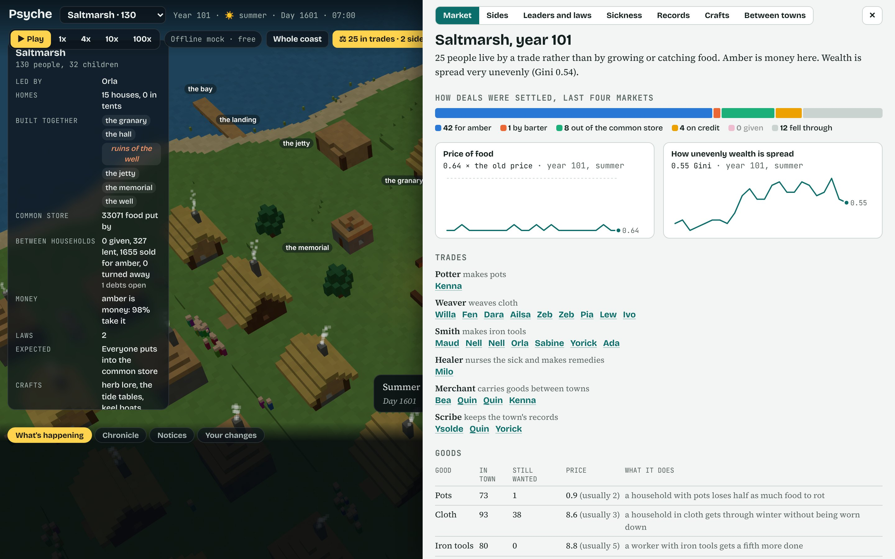
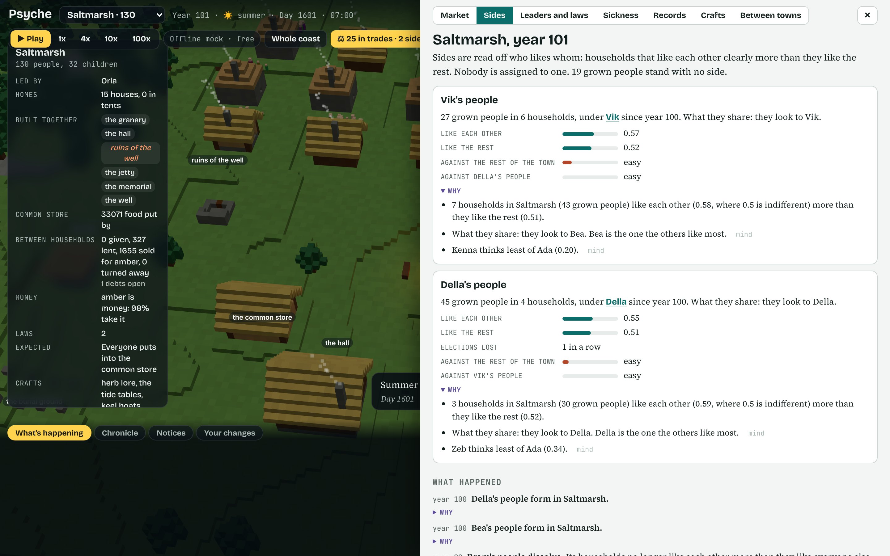
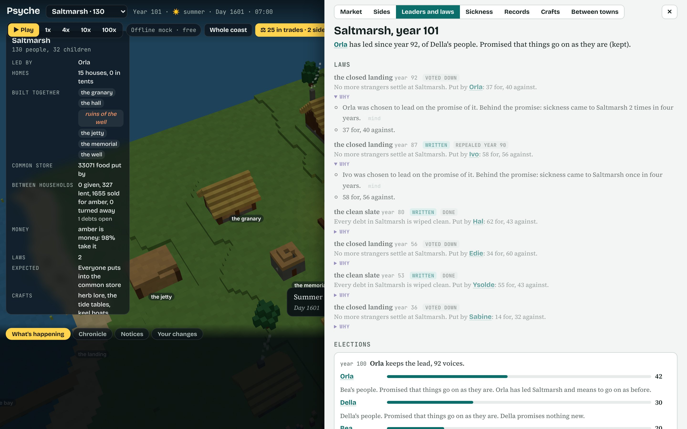
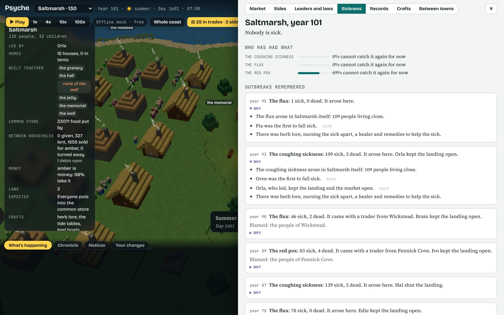
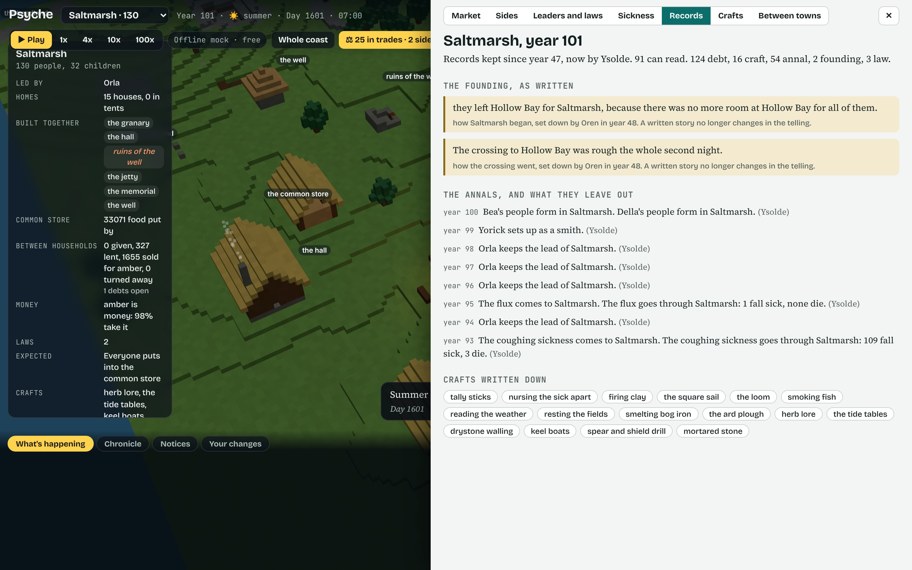
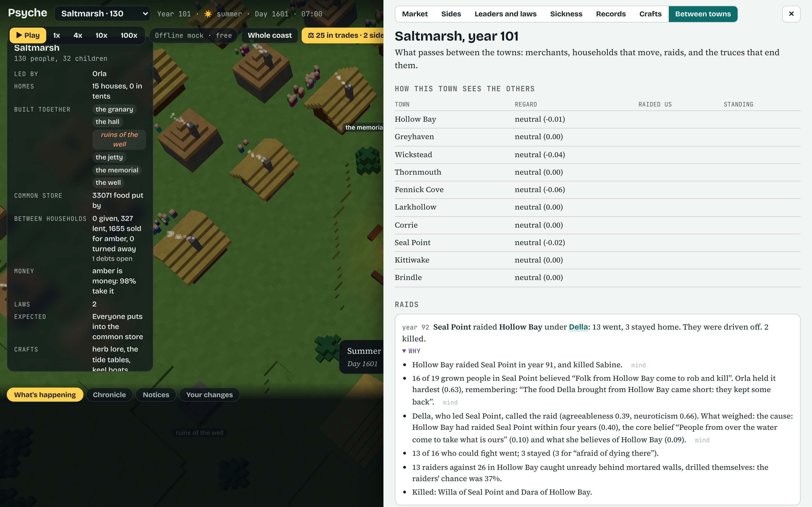
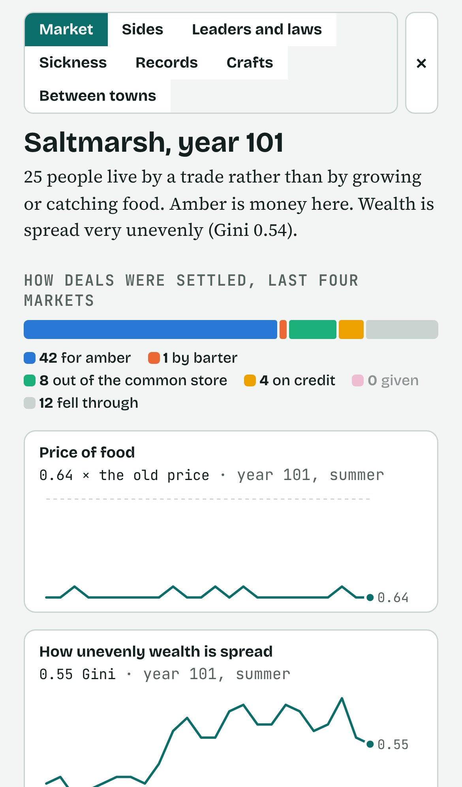

# The civilization systems

Seven systems that sit on top of the towns: trades and markets, sides, contested elections and laws, sickness, writing and records, households that move, raids and truces, and the later crafts that make several of them possible. They live in `packages/engine/src/world/civ/`.

Three rules hold for all of them.

- **Nothing is scripted.** Where a person decides something (what to ask for food in a hungry season, whether to shut the landing, whom to name as leader, whether to go on a raid, whether to leave town) the decision goes through that person's mind, with the things that pulled on it kept. In a town you are watching that is a full traced moment; in a town on rules it is the same options scored from the same traits, beliefs and relations.
- **Everything keeps its causes.** Each event carries a list of reasons recorded when it happened, and a reason that points at a person opens their mind. The chronicle, the town's own event list and the panel all show them.
- **They are off unless asked for.** A world runs them only when it has `village.civ` (`enableCiv(world)`; `RegionSession.create(seed, faculties, { civ: true })`). With them off, nothing changes: the 100-year run from before these systems existed still comes out the same, year for year. The server turns them on for a region; `PSYCHE_CIV=0` turns them off.

Nothing here calls a model on its own. Towns on rules use the region's cheap faculties (the offline mock on the server), so a century costs nothing.

```bash
npm run civ -- 100 7 2 out/civ     # a century on the mock, a minute or two; writes civ-report.md, civ.json and a save
PSYCHE_DATA=$PWD/out/civ npm run dev   # open that century in the game
```

A full report from one century (seed 7) is in [century-seed7.md](century-seed7.md): 804 people in 11 towns, 8 raids, 2 written truces, 64 outbreaks, 79 votes on laws, one example of every kind of event with its causes, and each town as it stood at the end.

## Markets and trades (`economy.ts`)

Six trades: potter, weaver, smith, healer, merchant, scribe. Someone can live by one once they know its craft and the town is big enough to carry them (the division of labour is limited by the extent of the market; Smith 1776). How many a town carries then follows what sells: four markets running with pots left unsold and one potter goes back to the fields; four with buyers going without and there is room for another.

Each season there is a market day. Every deal has to be settled somehow, and the ways are tried in order:

| How | When it works |
| --- | --- |
| Amber | The seller believes amber will buy something later. Each sale makes the next person likelier to take it, so a market is where amber becomes money. |
| Barter | Each side has something the other wants right now (Jevons 1875, the double coincidence of wants). |
| Credit | The seller knows and trusts the buyer. It is a debt like any other. |
| Out of the common store | A household that grows or catches food pays a maker from its claim on the store it fills. This is how a town keeps potters before it has money (redistribution; Polanyi 1957, Sahlins 1972). |
| Not at all | The deal falls through. |

Prices follow what the market showed: goods left unsold bring a price down, buyers left waiting after the sellers sold out bring it up. When food is short, each seller chooses whether to hold the old price, ask what it will fetch, or give. People remember who raised the price on them in a hungry season (Kahneman, Knetsch and Thaler 1986), and that memory feeds the sides and the laws.

What a household holds changes its days: pots keep food from rotting, cloth gets it through winter, tools make hours go further, remedies help its sick. Merchants carry goods to whichever town pays more.



## Sides (`factions.ts`)

Nobody founds a faction. Twice a year the engine looks at who likes whom, household by household, and a group counts as a side when its members like each other clearly more than they like the rest. It is named afterwards for what its members turn out to share: a family, a trade, having come late, a faith, owing or being owed, or simply the person they look to.

Once there are sides, people treat each other as sides (Tajfel and Turner 1979). It sharpens when there is something to compete for (Sherif 1961): a hungry season, a debt across the line, an election lost. A wrong done by one of them is held against all of them. It eases when the town is raided. Sides vote as blocs, come to blows at the fire, and a side that keeps losing may leave together and found a town.



## Leaders and laws (`polity.ts`)

Each spring the sitting leader, the head of each side and anyone else with standing are candidates. Each stands on one promise that comes out of their own life: a debtor promises a clean slate, someone who lost family to a sickness promises a closed landing, someone whose town was raided promises to answer it.

Every grown person names one. What weighs: liking and trust (Fiske, Cuddy and Glick 2007), whether the candidate is one of theirs, what the promise would do for their own household (Downs 1957), how the last year went under the sitting leader (Fiorina 1981), and whether the town was just attacked (Mueller 1970). The winner puts the promise to the town, and the town may vote it down.

Laws: a fair price in hungry seasons, a clean slate that wipes every debt (Hudson 1993; lenders who were wiped out stop lending for some years), a closed landing, and the store law from before. An unwritten law lapses when the leader who made it loses.



## Sickness (`disease.ts`)

Three sicknesses that pass from person to person. The spread is a plain contact model (Kermack and McKendrick 1927): the sick pass it to their own household and to a few others each day, survivors cannot catch it again for some years, and an outbreak burns out when it runs short of people. Crowding, hunger and bad water start one; a well, nursing, a healer and remedies decide how many die; traders, merchants, boats, raiders and households that move carry it between towns (McNeill 1976).

The leader chooses whether to shut the landing and the market. The bereaved look for someone to blame: the town it came from, newcomers, or the other side (Girard 1982). An anxious person who lost someone may come to hold "Strangers bring sickness" as a core belief (Schaller 2011), and it is passed to their children like any other.



## Writing and records (`records.ts`)

Until someone can write, a law is what the voters remember, a debt is two people's word, a craft dies with its last knower, and the founding story changes a little with each telling. Writing changes each of those (Goody and Watt 1963):

- a written law outlasts the leader who made it;
- a written debt is likelier to be paid;
- a craft that was written down is read back when everyone who knew it has died;
- the founding story, once written, stops drifting;
- each spring the scribe writes the year down, and tends to leave out what shames their own side or someone they are fond of. What was left out is kept too, with the reason.

Records burn in a raid.



## Households that move, raids and truces (`migration.ts`, `war.ts`)

A household head weighs leaving through their own mind (Lee 1966; Hirschman 1970). Hunger, not belonging, being on the losing side, debts, sickness and raids push. A town with more to eat and people they know there pull. Bonds, age and a house already built hold. A household takes everything with it: memories, crafts, beliefs, goods, amber, and any sickness it carries.

A raid is a chain of choices. Something has to be held against the other town (a shared belief that they cheat, brought the sickness or raided first, or plain hunger next to a full store). The leader chooses whether to call it. Every grown person then chooses whether to go, and a leader nobody follows has no raid. The fight goes by numbers, drill, walls and luck; people die in it by name, and the raided town remembers. Either side may ask for a truce, sometimes with tribute. A written truce holds for ten years whoever leads; an unwritten one may lapse when a signer loses the lead.



## Later crafts (`tech.ts`)

Ten crafts on top of the first seven: firing clay, the loom, tally sticks, the ard plough, nursing the sick apart, smelting bog iron, mortared stone, the square sail, writing, spear and shield drill. They are cumulative (writing needs tally sticks; Schmandt-Besserat 1992), they need people (a small town cannot find or keep them; Henrich 2004, Kline and Boyd 2010), and they answer pressure (the plough after hungry years, nursing after a plague, mortar after a raid; Boserup 1965). Once found they are ordinary crafts: taught parent to child, carried by traders and by households that move, and lost when the last knower dies untaught, unless someone wrote them down.

## In the game

The chip in the top bar (for example "25 in trades · 2 sides") opens the panel shown above, for the town you are watching. `GET /api/civ` returns the same data (`?town=` for another town). The chronicle and the lab's Towns view carry the new kinds of entry: market, sides, election, sickness, moved, written, raid, truce.



## What to expect from the mock

Centuries differ a good deal by seed. Seed 7 has 8 raids and a tribute truce; seed 11 has none and ends with 891 people in 11 towns; seed 23 grows to 1,233 people with 15 households moving. Food is rarely short in towns on rules, so the hungry-season paths (asking more for food, the fair price law, raids out of hunger) fire far less often than the rest. Sides come and go: most last a few years, a few last decades.
